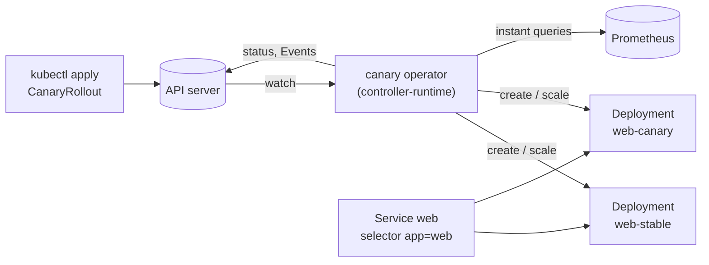
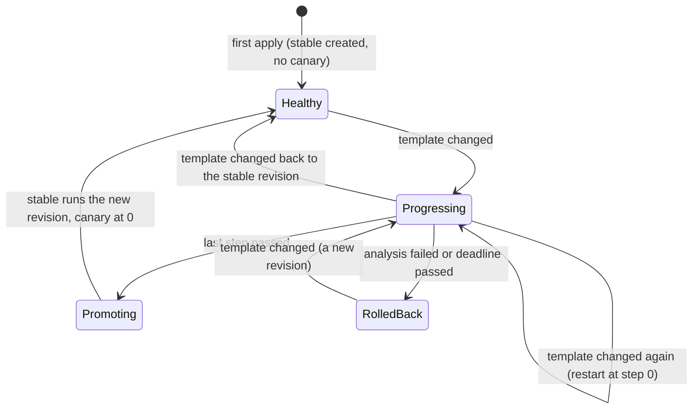

# Canary: design

A Kubernetes operator that rolls out a new version of an application gradually. A `CanaryRollout` holds a pod
template and a list of steps. When the template changes, the operator starts the new version (the *canary*) beside
the current one (the *stable*), moves a growing share of the pods to it step by step, checks Prometheus metrics
against thresholds during each step, and at the end either **promotes** the canary (it becomes the stable) or
**rolls it back** (its pods go away, the stable gets all of them again).

This file is the specification. Sections marked with a day are built on that day; the rest holds from day 1.

## The pieces



- **The operator** is one controller-runtime manager with one controller. It watches `CanaryRollout`s and the
  Deployments they own, and requeues itself while a step is timed.
- **Two Deployments per rollout**, both created and owned by the operator: `<name>-stable` and `<name>-canary`. Owner
  references mean deleting the `CanaryRollout` deletes both (Kubernetes' garbage collector does it).
- **Traffic is shifted by replica ratio.** The user's own Service selects the application's labels (`app: web`),
  which both Deployments' pods carry, so it sends connections to the pods of both. With 9 stable pods and 1 canary
  pod, about a tenth of new connections reach the canary. No service mesh or ingress is needed; the price is
  precision (see "Limitations").
- **Prometheus** answers the analysis queries. Its address is the operator's flag (`--prometheus-url`), not a field
  of the rollout, so whoever can create a `CanaryRollout` can't make the operator send requests to an address of
  their choosing. Tests use a fake behind the same interface (day 3).

## The API: `CanaryRollout` (`rollouts.vivekdavara.github.io/v1alpha1`)

The group is under `vivekdavara.github.io`, a domain the author controls, as API groups should be.

```yaml
apiVersion: rollouts.vivekdavara.github.io/v1alpha1
kind: CanaryRollout
metadata:
  name: web
spec:
  replicas: 10                 # pods in total, stable + canary
  template:                    # the version to run: a change starts a rollout
    metadata:
      labels: {app: web}
    spec:
      containers:
        - name: web
          image: example.com/web:1.4.0
  steps:                       # weights in percent of the pods, strictly increasing
    - weight: 10
      pause: 2m                # how long the step holds once its pods are ready
    - weight: 50
      pause: 5m
  progressDeadlineSeconds: 600 # a step whose canary pods aren't ready by then rolls back
  analysis:                    # optional: without it, steps advance on their pauses alone
    interval: 30s
    failureLimit: 1            # failed checks a step tolerates; one more rolls back
    metrics:
      - name: error-rate
        query: sum(rate(http_requests_total{app="web",track="canary",code=~"5.."}[1m])) / sum(rate(http_requests_total{app="web",track="canary"}[1m]))
        max: 10m               # 0.01 (a Kubernetes quantity: "10m" is 0.01)
      - name: p95-latency-seconds
        query: histogram_quantile(0.95, sum by (le) (rate(http_request_duration_seconds_bucket{app="web",track="canary"}[1m])))
        max: 300m
```

### Spec

| Field | Type | Rules |
|---|---|---|
| `replicas` | int32 | required, 1 to 1000 |
| `template` | PodTemplateSpec | required; its labels may not use the operator's prefix `rollouts.vivekdavara.github.io/` |
| `steps` | list, 1 to 20 | each `weight` 1 to 100, strictly increasing; each `pause` a duration from 0s to 24h (default 0s) |
| `progressDeadlineSeconds` | int32 | 1 to 86400, default 600 |
| `analysis.interval` | duration | 1s to 1h, default 30s |
| `analysis.failureLimit` | int32 | 0 to 100, default 0 |
| `analysis.metrics` | list, 1 to 10 | `name` a DNS label, unique; `query` 1 to 4096 characters; at least one of `min`, `max`; `min` <= `max` |

Every rule above is enforced by the API server, from the CRD's OpenAPI schema and its CEL rules
(`x-kubernetes-validations`), so a bad rollout is refused at `kubectl apply` with a message, rather than accepted
and then failing in the operator. Day 1's envtest tests check each rule against a real API server, refusals and
acceptances both.

Why these choices:

- **The rollout holds the template** (like Argo Rollouts' `Rollout`), rather than pointing at a Deployment the user
  owns (like Flagger). Then the operator owns everything it changes, and nobody else's controller edits the same
  objects.
- **Thresholds are `resource.Quantity`**, Kubernetes' exact decimal type (`10m`, `0.01`, `2`). CRDs discourage
  floating-point fields because they don't round-trip through every client exactly; a quantity does, and the API
  server checks its syntax.
- **`template.metadata` is kept.** controller-gen normally drops the schema of an embedded `ObjectMeta`, and the API
  server then prunes the template's labels on write, so the pods would lose the labels the Service selects.
  `crd:generateEmbeddedObjectMeta=true` keeps labels and annotations; a test reads them back.
- **Steps are percentages of `replicas`**, not pod counts, so changing `replicas` doesn't need the steps rewritten.

### Status

| Field | Meaning |
|---|---|
| `observedGeneration` | the `metadata.generation` the status describes |
| `updateRevision` | the revision of `spec.template` (below) |
| `stableRevision` | the revision the stable Deployment runs (day 2) |
| `canaryRevision` | the revision under test, empty when none (day 2) |
| `rolledBackRevision` | the last revision rolled back, so it isn't retried until the template changes (day 3) |
| `phase` | `Healthy`, `Progressing`, `Promoting` or `RolledBack` (day 2) |
| `currentStep` | the index of the step in progress (day 2) |
| `stepStartedAt` | when the current step's pods became ready and its pause began (day 2) |
| `stableReplicas`, `canaryReplicas` | ready pods of each (day 2) |
| `canaryWeight` | the canary's actual share of the pods, in percent, rounded down (day 2) |
| `conditions` | `Progressing`, `Available` (day 2), `AnalysisPassing` (day 3) |

**The revision** of a template is the first 16 hex digits of the SHA-256 of its JSON encoding. Go's encoder writes
struct fields in a fixed order and map keys sorted, and quantities in canonical form (`0.5` and `500m` encode the
same), so equal templates get equal revisions in every process. It goes on the pods as a label, so 16 hex digits
(64 bits) also keeps it well inside the 63-character limit for label values.

## The rollout (days 2 and 3)

### Splitting the pods

For a step of weight `w` percent and `R = spec.replicas`:

- `canary = ceil(R * w / 100)`, so every step runs at least one canary pod;
- `stable = R - canary`, except that a step below 100% never takes the last stable pod: if that leaves no stable pod,
  `stable = 1` and the rollout runs one pod more than `replicas` until it ends;
- `canaryWeight = floor(100 * canary / (canary + stable))` is reported, since it isn't always `w` (with `R = 3`,
  a 10% step runs 1 canary and 2 stable pods: 33%).

### The state machine



1. **First apply.** There is nothing to compare a first version with, so the operator creates the stable Deployment
   from the template at `replicas` pods, and no canary. Phase `Healthy`.
2. **Template change.** A revision other than the stable one (and other than `rolledBackRevision`) starts a rollout:
   the canary Deployment gets the template, step 0's split is applied. If a rollout is already in progress for
   another revision, it restarts at step 0 with the new one; if the template goes back to the stable revision, the
   canary is scaled to 0 and the rollout ends.
3. **A step.** First its pods must be ready: the canary Deployment's ready, updated pods equal the step's canary
   count. If that hasn't happened `progressDeadlineSeconds` after the step began, the rollout rolls back. Once ready,
   the step's pause runs; during it the analysis is checked every `interval`. When the pause is over (and, with an
   analysis, at least one check has passed since the step's pods were ready), the next step begins.
4. **Promotion.** After the last step the stable Deployment gets the canary's template and all `replicas` pods; once
   they are ready the canary goes to 0, `stableRevision` becomes the canary's, and the phase is `Healthy` again. The
   canary's pods stay up until the stable's new pods are ready, so capacity never drops.
5. **Rollback.** The canary goes to 0 pods, the stable back to `replicas`, the phase is `RolledBack`,
   `rolledBackRevision` records the revision, and a Warning Event says why. The operator doesn't retry that revision;
   a different template starts a new rollout.

The operator keeps no state of its own: everything it needs is in the status and the two Deployments, so a restart
(or a new leader) carries on where the last one stopped. Each reconcile computes the desired state from what it
reads, applies it, and asks to be requeued when the next timed event is due (the end of a pause, the next check,
the deadline).

### The objects the operator writes

- Deployment `<name>-stable` and `<name>-canary`, owned by the rollout (controller reference). Their selector is
  `{rollouts.vivekdavara.github.io/rollout: <name>, rollouts.vivekdavara.github.io/track: stable|canary}`, labels
  only the operator sets, so the two never select each other's pods. Deployment selectors are immutable, which is
  why the revision isn't in them; the revision label goes on the pod template.
- Pod labels added to the template: `.../rollout`, `.../track`, `.../revision`. A metric query can select
  `track="canary"` when Prometheus keeps pod labels.
- Events on the rollout: `RolloutStarted`, `StepAdvanced`, `Promoted`, `RolledBack`, `AnalysisFailed` (days 2-3).

The rollout's name becomes a prefix of Deployment and pod names, so the API server limits it to 50 characters.

## Analysis (day 3)

Each metric's `query` is sent to Prometheus as an instant query. The result must be one number: a scalar, or a vector
with exactly one sample. The check fails when the number is below `min` or above `max`, and also when the result is
empty, has more than one sample, is NaN or infinite, or the query errors or times out: an analysis that can't
measure doesn't pass (it fails closed). A step's checks fail the step when more than `failureLimit` of them have
failed since the step began.

## Testing

- **envtest** (`sigs.k8s.io/controller-runtime/pkg/envtest`) runs a real kube-apiserver and etcd (Kubernetes
  1.37.0, downloaded by `setup-envtest` into `bin/k8s`) with the CRD installed, but no controllers of Kubernetes'
  own: a Deployment never gets pods. The CRD's validation and the operator's writes are tested against it; tests
  that need ready pods set the Deployment's status themselves (days 2-3).
- **Unit tests** for the pure parts: revisions, the split, the state machine's decisions (day 2), the analysis's
  verdicts (day 3).
- **kind** in CI on day 4: a real cluster with a real Deployment controller, one rollout that passes and one that
  fails and rolls back.

## Limitations

- **Replica ratio is a coarse traffic split.** kube-proxy balances connections, not requests, so long-lived
  keep-alive connections stay where they were; with few pods the share is coarse (one pod of three is 33%, not the
  step's 10%). Exact per-request weights need a mesh or Gateway API `HTTPRoute` weights.
- **`replicas` is at least 1.** Scaling a rollout to zero isn't supported in v1alpha1.
- No HorizontalPodAutoscaler integration, no manual pause or approval, no webhook-based analysis.
