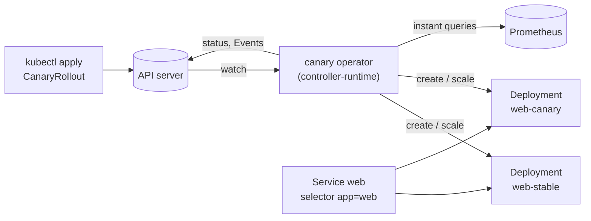
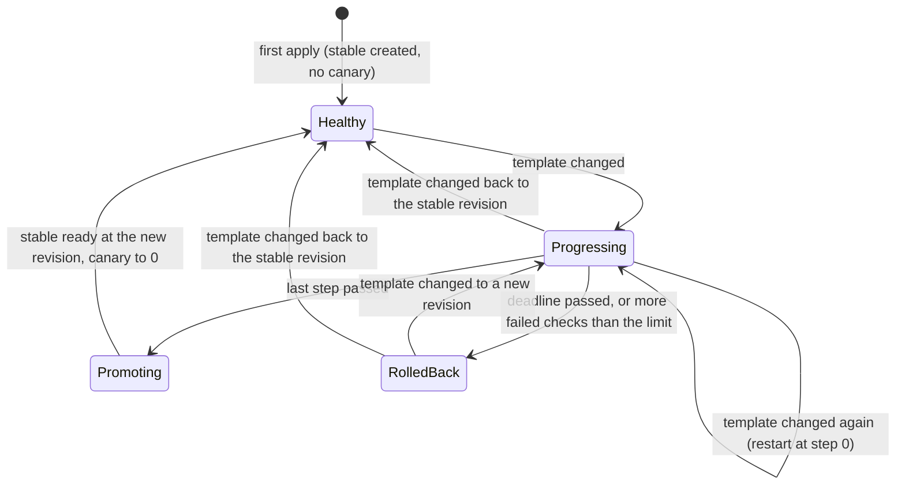

# Canary: design

A Kubernetes operator that rolls out a new version of an application gradually. A `CanaryRollout` holds a pod
template and a list of steps. When the template changes, the operator starts the new version (the *canary*) beside
the current one (the *stable*), moves a growing share of the pods to it step by step, checks Prometheus metrics
against thresholds during each step, and at the end either **promotes** the canary (it becomes the stable) or
**rolls it back** (its pods go away, the stable gets all of them again).

This file is the specification. Sections marked with a day are built on that day; the rest holds from day 1.

## The pieces



- **The operator** is one controller-runtime manager with one controller. It watches `CanaryRollout`s and the
  Deployments they own, and requeues itself while a step is timed.
- **Two Deployments per rollout**, both created and owned by the operator: `<name>-stable` and `<name>-canary`. Owner
  references mean deleting the `CanaryRollout` deletes both (Kubernetes' garbage collector does it).
- **Traffic is shifted by replica ratio.** The user's own Service selects the application's labels (`app: web`),
  which both Deployments' pods carry, so it sends connections to the pods of both. With 9 stable pods and 1 canary
  pod, about a tenth of new connections reach the canary. No service mesh or ingress is needed; the price is
  precision (see "Limitations").
- **Prometheus** answers the analysis queries. Its address is the operator's flag (`--prometheus-url`), not a field
  of the rollout, so whoever can create a `CanaryRollout` can't make the operator send requests to an address of
  their choosing. Tests use a fake Prometheus HTTP API (and fakes behind the `Querier` interface).

## The API: `CanaryRollout` (`rollouts.vivekdavara.github.io/v1alpha1`)

The group is under `vivekdavara.github.io`, a domain the author controls, as API groups should be.

```yaml
apiVersion: rollouts.vivekdavara.github.io/v1alpha1
kind: CanaryRollout
metadata:
  name: web
spec:
  replicas: 10                 # pods in total, stable + canary
  template:                    # the version to run: a change starts a rollout
    metadata:
      labels: {app: web}
    spec:
      containers:
        - name: web
          image: example.com/web:1.4.0
  steps:                       # weights in percent of the pods, strictly increasing
    - weight: 10
      pause: 2m                # how long the step holds once its pods are ready
    - weight: 50
      pause: 5m
  progressDeadlineSeconds: 600 # a step whose canary pods aren't ready by then rolls back
  analysis:                    # optional: without it, steps advance on their pauses alone
    interval: 30s
    failureLimit: 1            # failed checks a step tolerates; one more rolls back
    metrics:
      - name: error-rate
        query: sum(rate(http_requests_total{app="web",track="canary",code=~"5.."}[1m])) / sum(rate(http_requests_total{app="web",track="canary"}[1m]))
        max: 0.01
      - name: p95-latency-seconds
        query: histogram_quantile(0.95, sum by (le) (rate(http_request_duration_seconds_bucket{app="web",track="canary"}[1m])))
        max: 0.3
```

### Spec

| Field | Type | Rules |
|---|---|---|
| `replicas` | int32 | required, 1 to 1000 |
| `template` | PodTemplateSpec | required; its labels may not use the operator's prefix `rollouts.vivekdavara.github.io/` |
| `steps` | list, 1 to 20 | each `weight` 1 to 100, strictly increasing; each `pause` a duration from 0s to 24h (default 0s) |
| `progressDeadlineSeconds` | int32 | 1 to 86400, default 600 |
| `analysis.interval` | duration | 1s to 1h, default 30s |
| `analysis.failureLimit` | int32 | 0 to 100, default 0 |
| `analysis.metrics` | list, 1 to 10 | `name` a DNS label, unique; `query` 1 to 4096 characters; at least one of `min`, `max`; `min` <= `max` |

Every rule above is enforced by the API server, from the CRD's OpenAPI schema and its CEL rules
(`x-kubernetes-validations`), so a bad rollout is refused at `kubectl apply` with a message, rather than accepted
and then failing in the operator; the template must also have a pod spec. Day 1's envtest tests check each rule
against a real API server, refusals and acceptances both.

What the API server does *not* catch inside the pod template (found by day 1's review; DESIGN's goal still stands
for the fields above):

- **Ports in probes and lifecycle hooks beyond int32.** They are int-or-string fields, and the CRD's copy of the
  pod schema doesn't bound them, so `httpGet.port: 99999999999` is accepted and stored, and the operator's typed
  client then can't decode that object. Worse, a list is decoded as one document, so one such rollout anywhere in
  the cluster stopped day 1's operator from seeing any rollout (the review reproduced it). Since day 2 the operator
  reads and decodes each rollout on its own ("Reading rollouts", below); an undecodable one gets `Progressing` False
  with reason `InvalidSpec` and the decoder's message on its own status, and the others carry on
  (`TestOneUndecodableRolloutDoesNotStopTheOthers`).
- **Label syntax.** Template label keys and values aren't checked (the schema's labels are a plain string map). A
  CEL rule using `format.qualifiedName()` and `format.labelValue()` is over the cost budget, because the map has no
  size bound. The API server checks them when the operator creates a Deployment from the template, and the operator
  reports that refusal on the rollout (`InvalidSpec`, `TestATemplateTheAPIServerRefuses`); the same catches anything
  else a Deployment refuses that the CRD's schema let through.
- **A weight written as `10.0`** (from a raw-JSON client; kubectl writes `10`) fails the increasing-weights rule
  with an evaluation error rather than being accepted.

Why these choices:

- **The rollout holds the template** (like Argo Rollouts' `Rollout`), rather than pointing at a Deployment the user
  owns (like Flagger). Then the operator owns everything it changes, and nobody else's controller edits the same
  objects.
- **Thresholds are `float64`** (as in Flagger's `thresholdRange`). Kubernetes' API conventions discourage floats,
  because not every client re-encodes them identically, and controller-gen needs `crd:allowDangerousTypes=true` for
  them. But Prometheus answers in float64 and the comparison is made in float64, so a threshold of another type would
  be converted anyway, and `max: 0.01` reads as it should. The first version used `resource.Quantity` (exact
  decimals): `max: 0.01` unquoted was then refused (a quantity is an integer or a string), `10m` meant 0.01, and the
  API server refused the CRD itself, because the `min <= max` rule's estimated cost over unbounded quantity strings
  was 1.26 times its budget, and controller-gen won't put a `maxLength` on an int-or-string field.
- **`template.metadata` is kept.** controller-gen normally drops the schema of an embedded `ObjectMeta`, and the API
  server then prunes the template's labels on write, so the pods would lose the labels the Service selects.
  `crd:generateEmbeddedObjectMeta=true` keeps labels and annotations; a test reads them back.
- **Steps are percentages of `replicas`**, not pod counts, so changing `replicas` doesn't need the steps rewritten.
- **The CRD keeps its descriptions and is installed with server-side apply.** The full pod template schema with
  descriptions makes the CRD 636,521 bytes (`wc -c config/crd/bases/*`; 203,435 with `crd:maxDescLen=0`). A
  client-side `kubectl apply` copies the whole object into the `last-applied-configuration` annotation, and
  annotations are limited to 256 KiB, so it would fail; `kubectl apply --server-side` keeps no such copy. Stripping
  the descriptions would fit, but `kubectl explain canaryrollout.spec.steps` would then explain nothing.

### Status

| Field | Meaning |
|---|---|
| `observedGeneration` | the `metadata.generation` the status describes |
| `updateRevision` | the revision of `spec.template` (below) |
| `stableRevision` | the revision of the stable Deployment's template (its revision label); a promotion sets it when it starts, while the stable's pods are still being replaced |
| `canaryRevision` | the revision under test, empty when none |
| `rolledBackRevision` | the last revision rolled back, kept until another rollback replaces it; while it is the template's and the phase is `RolledBack`, the rollout holds |
| `phase` | `Healthy`, `Progressing`, `Promoting` or `RolledBack` |
| `currentStep` | the index of the step in progress (the last one during `Promoting`; after a rollback, the step that failed) |
| `stepStartedAt` | when the current step's pods became ready and its pause began; cleared when the step ends |
| `stepWaitingSince` | when the current step began waiting for its canary pods; the progress deadline runs from it; cleared when its pause begins |
| `analysis` | the current step's checks: `checks`, `failedChecks`, `lastCheckAt`; they start over with the step's pause (after a rollback, those of the step that failed) |
| `stableReplicas`, `canaryReplicas` | ready pods of each, as last read |
| `canaryWeight` | the canary's actual share of the ready pods, in percent, rounded down |
| `conditions` | `Progressing`, `Available`, `AnalysisPassing` ("Conditions" below) |

**The revision** of a template is the first 16 hex digits of the SHA-256 of its JSON encoding. Go's encoder writes
struct fields in a fixed order and map keys sorted, so the same template gets the same revision in every process.
Quantities encode in a canonical form *within their format* (`0.5` and `500m` encode the same), but the format is
kept: `1Gi` and `1073741824` are equal and get different revisions, so rewriting a quantity in another format starts
a rollout of what is the same template (`TestQuantityFormatIsPartOfTheRevision`). It goes on the pods as a label, so 16 hex digits
(64 bits) also keeps it well inside the 63-character limit for label values.

## The rollout (day 2; the analysis and rollback, day 3)

### Splitting the pods

For a step of weight `w` percent and `R = spec.replicas`:

- `canary = ceil(R * w / 100)`, so every step runs at least one canary pod;
- `stable = R - canary`, except that a step below 100% never takes the last stable pod: if that leaves no stable pod,
  `stable = 1` and the rollout runs one pod more than `replicas` until it ends;
- `canaryWeight = floor(100 * canary / (canary + stable))` is reported, since it isn't always `w` (with `R = 3`,
  a 10% step runs 1 canary and 2 stable pods: 33%). It is computed from the pods that are ready.

`rollout.Split` is checked against these rules for all 100,000 inputs the API allows
(`TestSplitHoldsForEveryAllowedInput`).

### The state machine



`rollout.Decide` is the whole state machine as one pure function: from the spec, the template's revision, the last
status and what the operator read of its two Deployments, it returns each Deployment's target (replicas, and whether
its pod template becomes the rollout's), the next status, the `Progressing` condition's reason and message, when to
be woken (the end of a pause) and the Events to record. The reconciler only reads, calls it, and writes (and, when the decision says a check is due, runs the check and calls
it again: "Analysis", below).

1. **First apply.** There is nothing to compare a first version with, so the operator creates the stable Deployment
   from the template at `replicas` pods, and no canary. Phase `Healthy`. The same happens if the stable Deployment is
   deleted: the version it ran is gone with it, so the template becomes the stable version (skipping any steps
   left). A canary keeps its pods until the new stable's are ready, since they may be the only ones serving.
2. **Template change.** A revision other than the stable's starts a rollout at step 0: `canaryRevision` records it,
   and the canary Deployment gets the template. If a rollout is already in progress for another revision, it restarts
   at step 0 with the new one.
3. **A step.** The canary is scaled to the step's count first; the stable keeps the pods it has until the step's
   canary pods are ready, and only then goes down to the step's count, so capacity doesn't drop while new pods start.
   "Ready" is what `kubectl rollout status` waits for, with ready pods: the Deployment controller has seen the latest
   spec (`observedGeneration`), and its updated, ready and total pods all equal its replicas. Once the step's canary
   pods are ready, `stepStartedAt` is set and the step's pause runs from then (time spent waiting for pods doesn't
   count, and a pod lost later doesn't restart it). The start is rounded up to a whole second, because the API
   server stores status times to the second: a start written with its fraction and read back truncated would end
   the pause up to a second early. When the pause is over the next step begins; a step with a 0s pause passes
   straight through, so the stable never goes down to that step's count. With analysis, the step also needs a passing
   verdict ("Analysis", below), and the wait for its pods is bounded by the progress deadline ("Rollback", below).

   **A pause belongs to the pods it started with.** If the canary no longer runs the template's revision (a status
   write was lost while the template changed and changed back), or is set to another count than the step's (the
   steps or `replicas` were edited, or cut so the index fell back to an earlier step), the step waits for its pods
   again (under the capacity rules below) and its pause starts over. One exception: a pause already over with the
   canary set to *more* pods than the step's. That is what a status write lost at a step advance leaves (the canary
   already at the next step's count; weights strictly increase, so never fewer), and the step mustn't run again. A
   canary set to fewer pods means a raised weight or more `replicas`, so the new share waits to be seen even if the
   edit made the pause over at once. The review rounds found both of my earlier versions of this rule wrong: the
   first re-ran finished steps, the second let an edit skip a raised weight. A 0s pause is over at once (the start's
   rounding doesn't make it wait). While a pause runs, the stable goes down to the step's
   count only while the step's canary pods are all ready, so a `replicas` edit during a lost canary pod can't take
   the stable below what the ready pods need.
4. **Promotion.** After the last step the stable Deployment takes the template at `replicas` pods (phase
   `Promoting`). The operator's Deployments replace pods with `maxUnavailable: 0`, and the canary keeps the pods it
   has until the stable's are all ready at the new revision; then the canary goes to 0 and the phase is `Healthy`
   again. `currentStep` stays at the last step (kept in range if the steps are cut meanwhile). The promotion marks the
   stable with the annotation `rollouts.vivekdavara.github.io/promoted-revision: <revision>`, in the same update as
   its template. A stable so marked for the revision under test while the status still says `Progressing` is a
   promotion whose status write was lost, and is carried on as one (with its lost `Promoting` Event). A stable at
   that revision without the mark was recreated from the template after being deleted, and the rollout simply ends
   (no `RolloutReverted`: the template didn't go back). The mark replaced a guess from the step index, which the
   third review round showed wrong both ways.
5. **The template back to the stable's revision** mid-rollout ends the rollout (`RolloutReverted`): the stable goes
   back to `replicas` pods, and the canary keeps its pods until the stable has them all, then goes to 0.

The capacity rules, all in `Decide`, each failing the random walks (`TestRandomWalks`) when removed: the canary is
scaled up before the stable down; the canary is kept during a promotion and after a revert until the stable is ready
at all replicas; and **a canary with more pods than the current step's** (a restart from a later step, or a new
rollout started while the last one's canary still drains) is neither scaled down nor given the new template until the
stable is settled at its count. Scaling it down first would drop capacity; giving it the new template at its old
count would send the new version more than the step's share. The random walks found that last case while `Decide`
was being written. A second walk, `TestRandomWalksWithEdits`, makes the moves the first never did (editing steps
and `replicas`, changing the template mid-rollout, deleting either Deployment, losing a status write), each
thousands of times, also loses ready pods and loses status writes independently of the move, and checks that no
decision takes the ready pods below `min(replicas, what was ready)`, that a pause only runs for a canary that ran the
template's revision, and (in the half of the walks that make no edits) that no step's pause starts twice.

Two cases it allows, on purpose, both a status write lost at a step advance: a step with a 0s pause whose single
decision (pods ready, pause over, next step) loses its write runs again, since the next decision can't tell the step
passed (the status never recorded its start); and a lost advance followed by a `replicas` increase leaves the canary
with fewer pods than the step now needs, which looks like an edit, so the step's pause runs again (the fourth review
round). Capacity holds in both and the new version's share only shrinks; it costs a pod or a second pause. Fixing
them means recording the step on the canary Deployment, written with its replicas (not done yet).

The operator keeps no state of its own: everything it needs is in the status (phase, `canaryRevision`,
`currentStep`, `stepStartedAt`) and the two Deployments (the revision each runs is its pod template's revision label),
so a restart or a new leader carries on where the last one stopped (`TestANewOperatorCarriesOn`). Each reconcile asks
to be requeued at the end of a pause; everything else wakes it through its watches.

### One reconcile

1. Read the rollout from the API server as unstructured JSON and decode it ("Reading rollouts", below). A rollout
   being deleted (`deletionTimestamp` set) is left alone: with a foreground delete the garbage collector removes the
   Deployments first, and recreating them would fight it.
2. Read `<name>-stable` and `<name>-canary` from the cache. One that exists but isn't controlled by this rollout is
   someone else's: the operator leaves it alone and reports `Progressing` False, reason `DeploymentConflict`. Besides
   the Deployments it owns, the operator watches Deployments with a rollout's names that no rollout controls, so
   deleting such a Deployment wakes the rollout and the conflict clears itself (`TestSomeoneElsesDeploymentWithTheName`).
   A Deployment of the rollout's deleted by hand comes back at the next reconcile (`TestADeletedDeploymentComesBack`).
3. `Decide`. If it says a check is due, run the check (each query bounded by `--analysis-timeout`) and `Decide` again
   with its result ("How a check fits a pure state machine", below).
4. **Write the Deployments**: create one the plan needs, or update its replicas, and its pod template when the plan
   takes the template and the revision label differs. Updates carry the `resourceVersion` read, so a stale cache read
   gets a conflict instead of undoing a newer write; a conflict ends the reconcile (the newer object is an event of its
   own). A Deployment the API server refuses as invalid (the CRD accepted a template a Deployment can't have: a label
   value with `!`, an invalid container name) ends it with `Progressing` False, reason `InvalidSpec`, the API
   server's message, and a Warning Event; nothing more is written until the template changes.
5. **Then the status**, if it changed, with the optimistic lock. The Deployments go first so that a refused
   Deployment leaves the status describing what really runs. The other failure, a status write lost after the
   Deployments were written, is handled in `Decide`: the one that matters is a promotion's (the stable already runs the
   revision under test while the status still says `Progressing`), so a stable at the revision under test counts as
   a promotion (`TestAPromotionWhoseStatusWasLost`).
6. **Then the Events**, only if the status write succeeded: a reconcile whose write lost a conflict decides again from
   the same last status, and would otherwise repeat them.

### Reading rollouts

The API server can store a rollout the typed client can't decode ("What the API server does not catch", above), and
a typed cache decodes every rollout in one list, so one such object stopped day 1's operator for all of them. The
operator now watches rollouts metadata-only (`builder.OnlyMetadata`) and reads each one with a GET as unstructured
JSON, decoding it itself. The price is one GET per reconcile instead of a cache read. Deployments are read from the
cache: the API server validated them in full.

### The objects the operator writes

- Deployment `<name>-stable` and `<name>-canary`, owned by the rollout (controller reference, so deleting the rollout
  deletes them). Their selector is `{rollouts.vivekdavara.github.io/rollout: <name>,
  rollouts.vivekdavara.github.io/track: stable|canary}`, labels only the operator sets, so the two never select each
  other's pods. Deployment selectors are immutable, which is why the revision isn't in them; the revision label goes
  on the pod template. Strategy: rolling update with `maxUnavailable: 0` and `maxSurge: 25%`.
- Pod labels added to the template: `.../rollout`, `.../track`, `.../revision`. A metric query can select
  `track="canary"` when Prometheus keeps pod labels.
- The operator compares a Deployment's template only by its revision label: a hand edit to a Deployment's pod
  template isn't undone (a hand edit to its replicas is, at the next reconcile). The rollout's template is the way to
  change the pods.
- Permissions (`config/rbac/role.yaml`, generated): rollouts get, list, watch; their status patch; their
  finalizers update, which the controller reference's `blockOwnerDeletion` needs on clusters running the
  `OwnerReferencesPermissionEnforcement` admission plugin (OpenShift does; a test starts an API server with it);
  Deployments list, watch, create, update (reads come from the cache, so no get); Events create and patch.
- Events (events.k8s.io/v1) on the rollout: `RolloutStarted`, `StepAdvanced`, `Promoting`, `Promoted`,
  `RolloutReverted` (Normal); `InvalidSpec`, `DeploymentConflict`, `AnalysisFailed` (each failed check, with every
  metric's value), `RolledBack` (Warning). A note is cut to 1 KiB, the API's limit for an Event's note (a longer one
  is refused and the Event lost).

### Conditions

| Type | Status | Reasons |
|---|---|---|
| `Progressing` | True while a rollout runs | `WaitingForCanary` (a step's canary pods aren't all ready), `StepPaused` (its pause is running; the message says until when), `Promoting` |
| `Progressing` | False otherwise | `Idle` (no rollout), `RolledBack` (the message says why, and is kept while the rollout holds), `InvalidSpec` (undecodable, or a Deployment refused), `DeploymentConflict` |
| `Available` | True or False | `EnoughPodsReady` or `NotEnoughPodsReady`: whether the two Deployments' ready pods add up to `replicas` |
| `AnalysisPassing` | True or False | `ChecksPassed` or `CheckFailed`: the last check, written when one runs: the step, the check's number, the failures so far and the limit, and every metric's value against its bounds (failed metrics first) |

The rollout's name becomes a prefix of Deployment and pod names, so the API server limits it to 50 characters.

## Analysis (day 3)

### A metric's verdict

Each metric's `query` is sent to Prometheus as an instant query (`POST /api/v1/query`, the query as a form field so a
long one fits, evaluated at Prometheus's own time). The answer must be one number: a scalar, or a vector with exactly
one sample. The metric passes when that number is within `[min, max]`, both inclusive. It fails in every other case:
below `min` or above `max`, NaN or infinite, an empty vector, more than one sample, a matrix or a string, a
native-histogram sample, an API error (`bad_data`, `timeout`, ...), an answer that isn't the API's (a proxy's HTML
error page), a success with an HTTP error code, an answer over 1 MiB, a refused connection, or no answer within the
operator's `--analysis-timeout` (10s by default). An analysis that can't measure doesn't pass: it fails closed.
Without `--prometheus-url` every check fails, with a message naming the flag. A **check** runs every metric once (in
parallel) and passes when all of them pass (`internal/analysis`: `Evaluate` is the verdict, `Run` the check,
`Prometheus` the client).

Why fail closed: a check that passes when it can't measure would promote a version nobody measured. The opposite
mistake, rolling back a good version during a Prometheus outage, costs a retry, and the Events and the
`AnalysisPassing` condition say which metric couldn't be read and why. `failureLimit` tolerates short outages.

### When checks run

Checks belong to a step's pause. The first is due one `interval` after the pause starts (a check at the very start
would measure pods that have had no traffic yet, and an empty answer fails), and each next one an `interval` after the
last. A step with analysis passes only when its pause is over **and** it has had at least one check, so a pause
shorter than the interval (a 0s pause included) lasts until the first check. With a 2m pause and a 30s interval, the
checks run at 30s, 60s, 90s and 120s, and the step passes on the last.

Each check's time is kept rounded *down* to the second (the API server stores status times to the second), so the
next check is due at most an interval after it. Rounded up, every check would be up to a second late, and a 1s
interval checked only every 2s (an envtest test found that).

The checks start over with the pause: an edit that restarts a step's pause (its pods change) also clears its checks
and failures. `analysis.failureLimit` is read at every decision during a pause: more failed checks than the limit
roll back, right after a failed check or as soon as the limit is lowered below the failures so far.

### How a check fits a pure state machine

`Decide` stays pure. A decision whose check is due says so (`Plan.AnalysisDue`) and otherwise just holds the step; the
reconciler then runs the check (`analysis.Run`) and calls `Decide` again with the same input, the same clock reading
included, plus the result (`Input.Check`). The second decision records it: `analysis.checks` and, if it failed,
`failedChecks` go up, `lastCheckAt` is set, the `AnalysisPassing` condition gets the result, a failed check records a
Warning `AnalysisFailed` Event, and more failures than the limit roll back in the same decision. The unit tests run
checks the same way (`world.run` in `internal/rollout/decide_test.go`).

A check whose status write is lost (a conflict) is due again at the next reconcile and runs again: the lost result
isn't counted, and its Event isn't recorded (Events go out only after the status write).

## Rollback (day 3)

Two things roll a rollout back:

- **The progress deadline.** A step that began waiting for its canary pods `progressDeadlineSeconds` ago (600 by
  default) and still has no pause running. The wait starts when the step does (`stepWaitingSince`: a new rollout, the
  next step, a pause that restarts after an edit) and ends when the step's pods are ready. The operator asks to be
  woken at the deadline, so it fires with no other event. It covers anything that keeps a step from starting: canary
  pods that crash or can't be scheduled, and a stable that must be back to its count before an oversized canary may
  shrink.
- **The analysis.** More failed checks in a step than `failureLimit`.

A rollback (`phase: RolledBack`, `rolledBackRevision` set, `canaryRevision` cleared, a Warning `RolledBack` Event, and
`Progressing` False with reason `RolledBack` and the cause) takes the stable back to `replicas` pods with the template
it has, the old version, and keeps the canary's pods until the stable's are all ready; then the canary goes to 0. The
rollout then **holds**: while the template is the revision rolled back, nothing is retried, and the `Progressing`
message written at the rollback (why it failed) is kept. A template change ends the hold: a new revision starts a
rollout, and the stable's own revision is simply `Healthy`. To retry the same version, change something in the
template (an annotation will do), which makes it a new revision.

Rules, and why:

- **No rollback once promotion starts.** Promotion gives the stable Deployment the new template, and the stable's
  template was the only copy of the old version, so there is nothing left to roll back to. A version reaches promotion
  only after passing every step.
- **A deleted stable isn't recreated from a rolled-back template.** Otherwise a deleted stable is recreated from the
  template ("The state machine", 1). After a rollback the template *is* the failed version, and recreating the stable
  from it would run that version at all replicas with no canary and no analysis. The operator creates nothing and
  says so (`Progressing` False, `RolledBack`, "the stable Deployment is gone ... set the template to the version to
  run"); a template change recreates it.
- **A rollback whose status write is lost is decided again.** The Deployments are written first, so the stable may
  already be back at `replicas`. The next decision rolls back again if the deadline is still past; after a failed
  check, a new check runs, and if that one passes the rollout carries on and the stable comes back down to the step's
  count (capacity holds throughout).
- **The canary drains under the capacity rules.** A new rollout started while a rolled-back canary still drains treats
  it as any canary with more pods than its step's (`waitForCanary`): kept until the stable is settled.

## Testing

- **envtest** (`sigs.k8s.io/controller-runtime/pkg/envtest`) runs a real kube-apiserver and etcd (Kubernetes
  1.37.0, downloaded by `setup-envtest` into `bin/k8s`) with the CRD installed, but no controllers of Kubernetes'
  own: a Deployment never gets pods. The CRD's validation and the operator's writes are tested against it; tests
  that need ready pods set the Deployment's status themselves (days 2-3).
- **The operator's permissions are the generated ones.** Tests run the operator as an envtest user holding only
  `config/rbac/role.yaml` (and, with `--leader-elect`, `leader_election_role.yaml` in the Lease's namespace), never as
  the administrator, so a permission the rbac markers miss fails a test.
- **The manifests are applied with kubectl**, the version envtest downloads with the API server, as the README says
  to (`config/install_test.go`).
- **Unit tests** for the pure parts: revisions, the split (every allowed input), the state machine (whole rollouts
  through a hand-simulated Deployment controller, and seeded random walks checking capacity, the status's consistency
  and how every walk ends, with analysis and the deadline in `TestRandomWalksWithAnalysis`), the analysis's verdicts
  and the Prometheus client against canned API responses.
- **The reconcile's own mechanisms** are tested by calling `Reconcile` by hand through an interceptor client: the
  optimistic lock (the spec changes between read and patch), and that a reconcile with nothing new writes nothing.
- **kind** in CI on day 4: a real cluster with a real Deployment controller, one rollout that passes and one that
  fails and rolls back.

## Limitations

- **Replica ratio is a coarse traffic split.** kube-proxy balances connections, not requests, so long-lived
  keep-alive connections stay where they were; with few pods the share is coarse (one pod of three is 33%, not the
  step's 10%). Exact per-request weights need a mesh or Gateway API `HTTPRoute` weights.
- **`replicas` is at least 1.** Scaling a rollout to zero isn't supported in v1alpha1.
- **A revision is tied to the encoding.** Building the operator against a newer `k8s.io/api` that adds a field
  without `omitempty` would give every unchanged template a new revision, and so start a rollout of everything it
  manages. `TestRevisionIsPinned` pins one template's revision so such an upgrade fails a test instead of shipping;
  the fix then would be to compare templates semantically rather than by hash.
- **Reconciles run one at a time**, and a check runs inside one, so a slow Prometheus holds up other rollouts by up to
  `--analysis-timeout` per check (the metrics of one check are queried in parallel).
- **The progress deadline runs per step from when the step began waiting**, and edits during the wait (more replicas)
  don't restart it.
- **`AnalysisPassing` describes the last check run**, possibly of an earlier rollout: it is written only by checks
  (its message names the step and the check's number).
- No HorizontalPodAutoscaler integration, no manual pause, approval or abort, no webhook-based analysis, no
  rollback after promotion has started.
