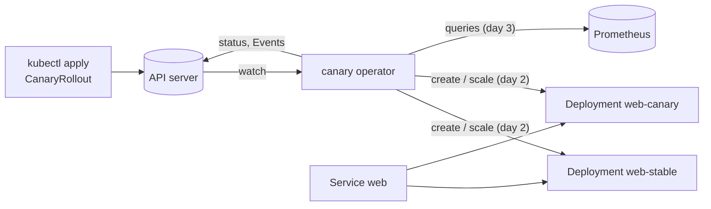

# Canary

A Kubernetes operator for canary rollouts. A `CanaryRollout` holds a pod template; when the template changes, the
operator runs the new version beside the old one in steps (10% of the pods, then 50%, ...), checks Prometheus metrics
against thresholds at each step, and either promotes the new version or rolls it back.

Status: **day 1 of 5** (design and scaffold): the API, its validation, template revisions and an observe-only
reconciler, all tested against a real API server (envtest). The rollout itself is day 2's. [DESIGN.md](DESIGN.md)
is the specification; [WALKTHROUGH.md](WALKTHROUGH.md) has the questions an interviewer is likely to ask.

Go 1.27, controller-runtime v0.25, Kubernetes 1.37 (envtest locally, kind in CI from day 4). MIT licensed.

## Why

Deploying a new version to every pod at once makes every user a tester. A canary sends a small share of traffic to
the new version first and checks it on real traffic (error rate, latency) before going further, and an operator
makes that a property of the cluster instead of a script someone has to run: the steps, thresholds and the decision
to promote or roll back live in one object, and the operator keeps acting on it through restarts.

## How it works



The operator owns two Deployments per rollout, and the application's own Service selects the pods of both, so the
canary's share of the traffic is its share of the pods. Each step waits for its canary pods to be ready, holds for
its pause while the analysis checks the metrics, and either moves on or rolls back. DESIGN.md has the API, the state
machine, the pod split and the analysis rules.

```yaml
apiVersion: rollouts.vivekdavara.github.io/v1alpha1
kind: CanaryRollout
metadata:
  name: web
spec:
  replicas: 10
  template: {...}            # a pod template, as in a Deployment
  steps:
    - weight: 10
      pause: 2m
    - weight: 50
      pause: 5m
  analysis:
    interval: 30s
    failureLimit: 1
    metrics:
      - name: error-rate
        query: sum(rate(http_requests_total{app="web",track="canary",code=~"5.."}[1m])) / sum(rate(http_requests_total{app="web",track="canary"}[1m]))
        max: 0.01
```

The full example is [config/samples/web.yaml](config/samples/web.yaml) (a test applies it).

## Layout

| Path | What |
|---|---|
| `api/v1alpha1/` | the `CanaryRollout` types, their validation markers and CEL rules; `zz_generated.deepcopy.go` is generated |
| `config/crd/bases/` | the CRD, generated from the types (`make manifests`) |
| `config/rbac/role.yaml` | the operator's ClusterRole, generated from the reconciler's rbac markers |
| `config/rbac/leader_election_role.yaml` | the Role for `--leader-elect`, in the Lease's namespace (written by hand) |
| `config/samples/` | example rollouts |
| `internal/revision/` | a template's revision: 16 hex digits of the SHA-256 of its JSON |
| `internal/controller/` | the reconciler |
| `internal/testenv/` | starts envtest (a real kube-apiserver and etcd) for a package's tests |
| `cmd/canary/` | the operator's binary |

## Run it

```bash
make check
```

That installs the pinned tools into `bin/` on first use (controller-gen v0.21.0, setup-envtest v0.25.2, and envtest's
kube-apiserver and etcd for Kubernetes 1.37.0), regenerates the deep copies, CRD and ClusterRole, and runs gofmt, go
vet and every test. A plain `go test ./...` skips the envtest suites; `make test` makes them fail instead if their
binaries are missing.

Against a cluster (kind, minikube, or any cluster your kubeconfig points at):

```bash
kubectl apply --server-side -f config/crd/bases
```

```bash
go run ./cmd/canary --kubeconfig ~/.kube/config
```

```bash
kubectl apply -f config/samples/web.yaml && kubectl get canaryrollouts
```

The CRD needs `--server-side`: with the pod template's schema and descriptions it is 637,212 bytes, and a client-side
apply would store all of it in an annotation limited to 256 KiB (DESIGN.md, "Why these choices"). On day 1 the
operator only records the template's revision and the generation it saw (`kubectl get crl` shows the revision); it
creates no Deployments yet. The operator serves metrics on `:8111` and `/healthz` and `/readyz` on `:8121`. With
`--leader-elect` (for more than one replica) it also needs `--leader-election-namespace` outside a cluster, and
`config/rbac/leader_election_role.yaml` bound in that namespace (the Lease and its Events).

## Tests

All against envtest's real API server unless marked unit.

| File | What it checks |
|---|---|
| `api/v1alpha1/validation_test.go` | each CRD rule refuses with its message, each boundary value is accepted, raw input the typed struct can't express (`pause: 1d`, a quoted threshold, missing required fields), the defaults, template labels surviving pruning, defaults filled inside the pod template, status as a subresource, the samples |
| `internal/revision/revision_test.go` (unit) | a pinned revision (checked against `shasum` of the JSON), a valid label value, every kind of change moves it, map order and quantity spelling don't |
| `internal/controller/canaryrollout_controller_test.go` | status follows the spec through template and replica changes; the rest of the status is kept; a missing rollout is no error. The operator runs as a user holding only the generated ClusterRole |
| `cmd/canary/main_test.go` | the binary from its flags and a kubeconfig: probes answer, a rollout is reconciled, the reconcile is counted in its metrics, a clean stop; with `--leader-elect` it takes the Lease using only the leader-election Role; `--help` |
| `config/install_test.go` | the README's install steps with envtest's kubectl: client-side apply of the CRD fails ("Too long"), `--server-side` works, the sample applies, `kubectl get crl` shows the columns |

Three checks that the tests can fail: removing the Deployments rule from `config/rbac/role.yaml` fails
`TestStatusFollowsTheSpec` in 12 s (the operator's Deployment cache never syncs); removing the Lease rule from
`leader_election_role.yaml` fails `TestRunElectsALeader` (it never leads, so nothing is reconciled in 15 s);
misspelling `failureLimit` in the sample fails `TestSamplesAreAccepted` ("unknown field").

## Results (day 1)

Nothing runs a rollout yet, so there are no rollout numbers. What was measured:

- The CRD is 637,212 bytes with descriptions and 203,982 without (`wc -c` on controller-gen's output with and
  without `crd:maxDescLen=0`).
- The first version of the thresholds (`resource.Quantity`) made the API server refuse the CRD: the `min <= max` CEL
  rule's estimated cost was 1.258302 times its budget (envtest's error on starting). With `float64` thresholds the
  CRD installs.

## CI

`.github/workflows/ci.yml`: `make check` on Ubuntu, then a check that the generated files were committed, then the
build. **It hasn't run yet**: the public GitHub repository couldn't be created from the scheduled session, so
nothing has been pushed (see the day's log).

## Design decisions

- The rollout holds the template and owns both Deployments, rather than pointing at a Deployment the user owns.
- Traffic moves by replica ratio through the application's own Service: no mesh needed, at the price of precision.
- Every rule a user can break is enforced by the API server (schema and CEL), not discovered later by the operator.
- Thresholds are `float64`, as Prometheus answers; the operator's Prometheus address is its flag, not the rollout's.
- The operator keeps no state of its own; everything is in the status and the Deployments.

## Limitations

- Day 1: no Deployments are created and nothing is analysed yet.
- Replica ratio is a coarse split (connections, not requests; one pod of three is 33%).
- `replicas` is at least 1; no HPA integration, no manual pause or approval.
- A `k8s.io/api` upgrade that changes the template's encoding would change every revision; a pinned test catches it.
