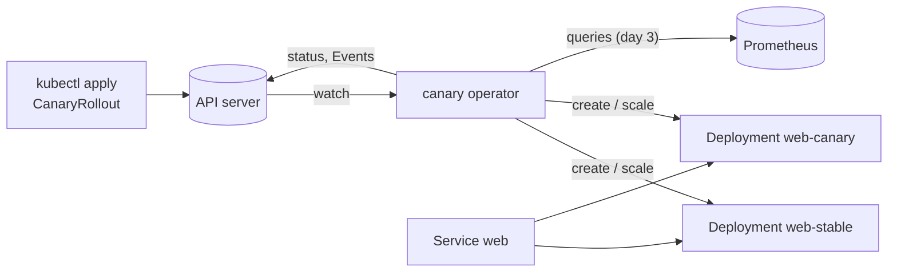

# Canary

A Kubernetes operator for canary rollouts. A `CanaryRollout` holds a pod template; when the template changes, the
operator runs the new version beside the old one in steps (10% of the pods, then 50%, ...), checks Prometheus metrics
against thresholds at each step, and either promotes the new version or rolls it back.

Status: **day 2 of 5**: the operator runs rollouts. On a template change it starts the new version in a canary
Deployment beside the stable one, moves pods to it step by step (each step's pause running once its pods are ready),
and promotes it after the last step, without ever dropping below `replicas` ready pods. Steps advance on their pauses
alone so far: the metric analysis and rollback are day 3's. [DESIGN.md](DESIGN.md) is the specification;
[WALKTHROUGH.md](WALKTHROUGH.md) has the questions an interviewer is likely to ask.

Go 1.27, controller-runtime v0.25, Kubernetes 1.37 (envtest locally, kind in CI from day 4). MIT licensed.

## Why

Deploying a new version to every pod at once makes every user a tester. A canary sends a small share of traffic to
the new version first and checks it on real traffic (error rate, latency) before going further, and an operator
makes that a property of the cluster instead of a script someone has to run: the steps, thresholds and the decision
to promote or roll back live in one object, and the operator keeps acting on it through restarts.

## How it works



The operator owns two Deployments per rollout, and the application's own Service selects the pods of both, so the
canary's share of the traffic is its share of the pods. Each step scales the canary up first, waits for its pods to
be ready, then scales the stable down and holds for its pause (from day 3, while the analysis checks the metrics);
after the last step the stable takes the new version and the canary keeps its pods until the stable's are ready.

The decisions are one pure function, `rollout.Decide`: from the spec, the last status and the two Deployments it
returns what each Deployment should become and the next status. The reconciler reads, calls it, writes the
Deployments, then the status, then the Events. DESIGN.md has the API, the state machine, the pod split, the order of
writes and what each failure leaves.

```yaml
apiVersion: rollouts.vivekdavara.github.io/v1alpha1
kind: CanaryRollout
metadata:
  name: web
spec:
  replicas: 10
  template: {...}            # a pod template, as in a Deployment
  steps:
    - weight: 10
      pause: 2m
    - weight: 50
      pause: 5m
  analysis:
    interval: 30s
    failureLimit: 1
    metrics:
      - name: error-rate
        query: sum(rate(http_requests_total{app="web",track="canary",code=~"5.."}[1m])) / sum(rate(http_requests_total{app="web",track="canary"}[1m]))
        max: 0.01
```

The full example is [config/samples/web.yaml](config/samples/web.yaml) (a test applies it).

## Layout

| Path | What |
|---|---|
| `api/v1alpha1/` | the `CanaryRollout` types, their validation markers and CEL rules; `zz_generated.deepcopy.go` is generated |
| `config/crd/bases/` | the CRD, generated from the types (`make manifests`) |
| `config/rbac/role.yaml` | the operator's ClusterRole, generated from the reconciler's rbac markers |
| `config/rbac/leader_election_role.yaml` | the Role for `--leader-elect`, in the Lease's namespace (written by hand) |
| `config/samples/` | example rollouts |
| `internal/revision/` | a template's revision: 16 hex digits of the SHA-256 of its JSON |
| `internal/rollout/` | the pod split and the state machine (`Decide`), pure functions |
| `internal/controller/` | the reconciler: reads, `Decide`, writes the Deployments, the status and the Events |
| `internal/testenv/` | starts envtest (a real kube-apiserver and etcd) for a package's tests |
| `cmd/canary/` | the operator's binary |

## Run it

```bash
make check
```

That installs the pinned tools into `bin/` on first use (controller-gen v0.21.0, setup-envtest v0.25.2, and envtest's
kube-apiserver and etcd for Kubernetes 1.37.0), regenerates the deep copies, CRD and ClusterRole, and runs gofmt, go
vet and every test. A plain `go test ./...` skips the envtest suites; `make test` makes them fail instead if their
binaries are missing.

Against a cluster (kind, minikube, or any cluster your kubeconfig points at):

```bash
kubectl apply --server-side -f config/crd/bases
```

```bash
go run ./cmd/canary --kubeconfig ~/.kube/config
```

```bash
kubectl apply -f config/samples/web.yaml && kubectl get canaryrollouts
```

The CRD needs `--server-side`: with the pod template's schema and descriptions it is 636,521 bytes, and a client-side
apply would store all of it in an annotation limited to 256 KiB (DESIGN.md, "Why these choices"). The sample
creates `web-stable` at 10 pods; change its image and `kubectl get crl -w` shows the phase, the step and the canary's
actual share as the pods become ready (`kubectl get deploy -l rollouts.vivekdavara.github.io/rollout=web` shows the
two Deployments, `kubectl events --for canaryrollout/web` the Events). The operator serves metrics on `:8111` and `/healthz` and `/readyz` on `:8121`. With
`--leader-elect` (for more than one replica) it also needs `--leader-election-namespace` outside a cluster, and
`config/rbac/leader_election_role.yaml` bound in that namespace (the Lease and its Events).

## Tests

All against envtest's real API server unless marked unit. envtest runs no Deployment controller, so the rollout tests
play its part: they write a Deployment's status (`markReady`) when its pods would be ready.

| File | What it checks |
|---|---|
| `api/v1alpha1/validation_test.go` | each CRD rule refuses with its message, each boundary value is accepted, raw input the typed struct can't express (`pause: 1d`, a quoted threshold, missing required fields), the defaults, template labels surviving pruning, defaults filled inside the pod template, status as a subresource, the samples |
| `internal/revision/revision_test.go` (unit) | a pinned revision (checked against `shasum` of the JSON), a valid label value, every kind of change moves it, map order and quantity spelling don't |
| `internal/rollout/split_test.go` (unit) | the split against DESIGN's rules for all 100,000 allowed inputs (replicas 1-1000, weight 1-100), and worked examples |
| `internal/rollout/review_d2_*_test.go` (unit) | the day 2 review's state-machine findings, as it wrote them |
| `internal/controller/review_d2_*_test.go` | the day 2 review's operator findings: a pause's full length (fixed clocks), a rollout being deleted, the role under `OwnerReferencesPermissionEnforcement` (a second API server with that plugin) |
| `internal/rollout/decide_test.go` (unit) | whole rollouts through a hand-simulated Deployment controller: first apply, steps, pauses timed from readiness, promotion, a restart mid-rollout, a revert, a template change during promotion, a deleted stable, steps shrinking, one pod, a promotion whose status write was lost; and 3,000 seeded random walks (pods settling one Deployment at a time, time passing, new templates, reverts) checking after every decision that ready pods never drop below `replicas`, that the status agrees with itself, and that every walk ends `Healthy` at the template; and 5,000 walks that also edit steps and replicas, change the template mid-rollout, delete either Deployment and lose status writes (each move counted, at least 1,000 times), checking that no decision takes ready pods below `min(replicas, what was ready)` |
| `internal/controller/rollout_test.go` | a whole rollout against the API server as the operator's own user: the stable's labels, selector, owner and strategy, the stable kept at 4 until the canary's pod is ready, the canary kept during the promotion, the four Events; a 2 s pause ending on its own requeue; a template the API server refuses as a Deployment, then fixed; someone else's Deployment with the rollout's name, reported, and the conflict clearing itself when it's deleted; Deployments deleted by hand coming back |
| `internal/controller/undecodable_test.go` | a rollout with a probe port beyond int32 (accepted, undecodable) gets `InvalidSpec` on its own status while another rollout keeps being reconciled |
| `internal/controller/rollout_test.go` (`TestARolloutsWrites`) | a whole rollout's writes counted at the operator's own client, and none in the two seconds after it ends: a guard against a reconcile that writes in a loop (a status carrying the time wrote 984 patches in those two seconds) |
| `internal/controller/reconcile_test.go` | `Reconcile` called by hand through an interceptor client: a status computed from a spec that changed before the patch is refused (the optimistic lock); a reconcile with nothing new writes nothing; a second operator (fixed clocks, ten minutes apart) keeps a paused step's start time |
| `internal/controller/canaryrollout_controller_test.go` | status follows the spec through template and replica changes; fields the reconciler doesn't own are kept; a missing rollout is no error |
| `cmd/canary/main_test.go` | the binary from its flags and a kubeconfig: probes answer, a rollout is reconciled, the reconcile is counted in its metrics, a clean stop; with `--leader-elect` it takes the Lease using only the leader-election Role; `--help` |
| `config/install_test.go` | the README's install steps with envtest's kubectl: client-side apply of the CRD fails ("Too long"), `--server-side` works, the sample applies, `kubectl get crl` shows the columns |

Checks that the tests can fail, each run as a mutant: removing any one of the three capacity rules in `Decide` fails
`TestRandomWalks`; the old typed watch fails `TestOneUndecodableRolloutDoesNotStopTheOthers`; a patch without the
optimistic lock fails `TestAStatusFromAnOlderSpecIsNotWritten`; dropping either "nothing changed" early return fails
`TestAReconcileWithNothingNewWritesNothing`; not passing `stepStartedAt` to `Decide` fails
`TestANewOperatorCarriesOn` (it didn't at first; see "What went wrong"); turning off the watch of same-named
Deployments fails `TestSomeoneElsesDeploymentWithTheName`. From day 1: removing the Deployments rule
from `config/rbac/role.yaml` fails `TestStatusFollowsTheSpec`; removing the Lease rule fails `TestRunElectsALeader`;
misspelling `failureLimit` in the sample fails `TestSamplesAreAccepted`.

## Results (day 2)

No cluster runs here (no kind locally; day 4 runs one in CI), so there are no rollout timings yet. What was measured
(Apple M3, on battery):

- `make check` warm: 17.51 s real (`/usr/bin/time -p make check` at `d1cec47`, with a review agent's tests running at
  the same time): 44 top-level tests (`go test -list '.*' ./... | grep -c ^Test`), all six packages `ok`, none
  skipped.
- `TestRandomWalks`: 3,000 walks of 60 random actions plus a settling tail, 0.12 s
  (`go test -run TestRandomWalks -v ./internal/rollout/`).
- A whole rollout of 4 pods (first apply, steps of 25% and 50% with no pauses, promotion) costs the operator **2
  creates, 3 Deployment updates and 9 status patches**, the same in three runs, and no write in the two seconds after
  it ends (`go test -run TestARolloutsWrites -v ./internal/controller/` with `KUBEBUILDER_ASSETS` set, at
  `951022f`; the test counts at the operator's own client). The stable never got a separate 4 -> 3 update: with no
  pause, step 2 began as soon as step 1's pod was ready.
- The CRD is unchanged from day 1: 636,521 bytes with descriptions.

## Review of day 1

One review agent at `2694208` reproduced 6 defects. Fixed on day 1: a template with no pod spec was accepted;
`--leader-elect` had no Lease permission. **Fixed on day 2: one rollout with a probe port over int32 stopped the
operator for every rollout** (rollouts are now read and decoded one at a time). Template label syntax is now checked
by the API server when the operator creates a Deployment, and a refusal is reported on the rollout. Still as
documented: `weight: 10.0` from a raw-JSON client fails with an evaluation error; equal quantities in different
formats get different revisions. The three reconciler mechanisms it listed as untested (the optimistic lock, the
no-change return, the conflict branch) have tests now, each run as a mutant (the conflict branch returning its error
fails `TestAStatusFromAnOlderSpecIsNotWritten` too).

## Review of day 2

One review agent at `3334dc0` (25 minutes, its own worktree, findings as failing tests, kept as `review_d2_*`)
reproduced 10 defects; two were already fixed by then (`d825984`, `4f6aa43`). Fixed:

- **Capacity, in the moves the random walks never made**: editing the steps or `replicas` during a pause applied the
  new split to both Deployments at once (7 of 10 pods ready); cutting the steps kept the old step's start time, so the
  rollout promoted at once and shrank the canary; a deleted stable took the canary to 0 before any new stable pod was
  ready. A pause now belongs to the pods it started with (DESIGN.md, "A step"), and a missing stable keeps the canary.
- **A lost status write while the template changed and changed back** left a pause running for a canary on the
  other revision, which then promoted.
- **Pauses ended up to a second early** (status times are stored to the second): starts are rounded up.
- **A rollout being deleted got its Deployments recreated** during a foreground delete.
- **The role wasn't enough under `OwnerReferencesPermissionEnforcement`** (OpenShift): no Deployment was ever
  created. `update` on `canaryrollouts/finalizers` added; `get` on Deployments (unused) removed.
- The Promoting Event was lost with a lost status write; `currentStep` could leave the steps' range in a promotion.
- Fixed meanwhile: a `DeploymentConflict` never cleared on its own; two tests raced the operator's status writes.

It also listed mechanisms it could remove with every test passing (the readiness rule's parts, Events only after a
status write, `Available` going False, `canaryWeight`, the undecodable report's lock and skip, Warning vs Normal):
each has a test now, run again as a mutant. And it named what the random walk never did (edit steps or replicas,
delete a Deployment, lose a write, change the template mid-rollout): `TestRandomWalksWithEdits` does each thousands
of times, and fails with the pause fix, the deleted-stable fix or the step clamp removed.

## What went wrong on day 2

- The random walks found a capacity drop in my first `Decide`: a new rollout started while the last one's canary
  was still draining scaled that canary down before the stable was back at full size. The fix holds an oversized
  canary until the stable is settled.
- The 2 s pause test found that a reconcile with nothing to write returned without the pause's requeue, so a paused
  step only ended if something else happened to wake the operator.
- My first restart test passed with the mechanism it tests removed: status times are stored to the second and the
  test took less than one, so a reset start time looked the same. I committed it chained after the mutant run
  anyway (`cdd6226`, whose message says the mutant fails); `b4ed977` gives each operator a fixed clock and says so.

## CI

`.github/workflows/ci.yml`: `make check` on Ubuntu, then a check that the generated files were committed, then the
build.

## Design decisions

- The rollout holds the template and owns both Deployments, rather than pointing at a Deployment the user owns.
- Traffic moves by replica ratio through the application's own Service: no mesh needed, at the price of precision.
- Every rule a user can break is enforced by the API server (schema and CEL), not discovered later by the operator;
  what the schema can't check inside the pod template, the Deployment's own validation does, reported on the rollout.
- The state machine is a pure function; the reconciler only reads and writes. It keeps no state of its own:
  everything is in the status and the Deployments.
- Capacity first: scale up before down, keep the old pods until the new ones are ready, `maxUnavailable: 0`.
- Deployments are written before the status, Events after it.
- Thresholds are `float64`, as Prometheus answers; the operator's Prometheus address is its flag, not the rollout's.

## Limitations

- Day 2: no analysis, no rollback and no progress deadline yet (day 3); steps advance on their pauses alone.
- Editing the steps or `replicas` mid-pause restarts the step's pause (its pods change).
- A restart from a later step, or a new rollout right after a revert, keeps the old canary's pods (old version) until
  the stable is back at its count: capacity over speed.
- A hand edit to a Deployment's pod template isn't undone (templates are compared by their revision label).
- If the stable Deployment is deleted, the version it ran is gone: the operator recreates it from the template.
- One GET per reconcile for the rollout itself (the price of decoding rollouts one at a time).
- Replica ratio is a coarse split (connections, not requests; one pod of three is 33%).
- `replicas` is at least 1; no HPA integration, no manual pause or approval.
- A `k8s.io/api` upgrade that changes the template's encoding would change every revision; a pinned test catches it.
